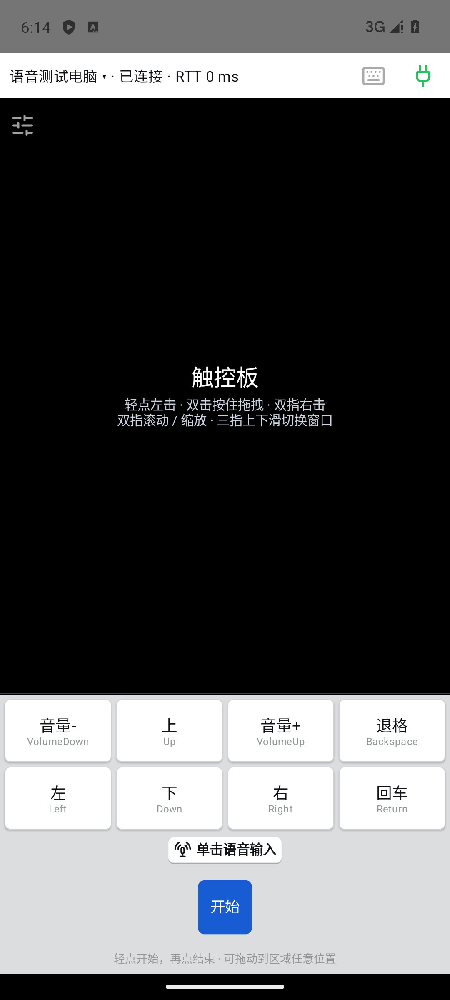
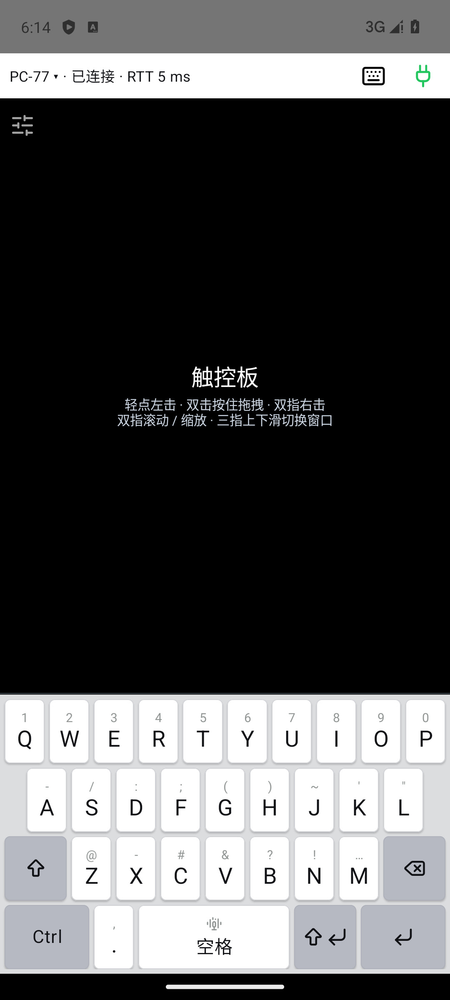

# TapDeck

[简体中文](README.md) | English

Turn your Android phone into a wireless microphone, touchpad, keyboard and pocket monitor for your Windows PC over local Wi-Fi, and get your PC's notifications on the phone. Built for vibe coding with AI agents and for everyday use.

**[Windows EXE](https://github.com/fly3457/TapDeck/releases/download/v0.5.21/TapDeck-0.5.21.exe) · [Android APK](https://github.com/fly3457/TapDeck/releases/download/v0.5.21/TapDeck-0.5.21.apk) · [All downloads and checksums](https://github.com/fly3457/TapDeck/releases/tag/v0.5.21)**

Beta **0.5.21** · Android **code 46** · Windows 11 x64 · Android 8+ · same local network

> The app UI and the detailed docs are currently in Simplified Chinese only.

The Android APK is a non-debuggable release build. It installs over an existing official build and keeps your pairings and phone settings.

## Demo

Ask an agent by voice to build a brick-breaker game, switch the phone to a pocket screen to read the code and play the game, then keep driving the PC with the touchpad and voice (about 100 seconds, PC on the left and phone on the right, recorded in sync):

https://github.com/user-attachments/assets/63286878-38a4-4d2d-9d42-9e5dcd514358

## Features

**Voice input**: your phone's microphone streams audio to the PC, where an input method (such as Doubao IME) or an AI agent with voice input turns it into text. Up to three voice profiles; start and stop with press-and-hold or a single tap.

**Touchpad and keyboard**: tap, drag, two-finger scroll and zoom, and three-finger window gestures. Switch to a full keyboard for letters, digits, symbols and key combinations. Up to eight custom shortcut keys.

**Video mode (your phone as a pocket monitor)**: the whole phone screen shows your PC's display, and you operate it by touching what you see. Works in portrait and landscape. See [Video mode](docs/video-mode.md) (Chinese).
- Low-latency hardware H.264 streaming. Measured on an RTX 2060 with a nubia phone: about 30 ms end to end when the picture is mostly still, about 40 ms while scrolling a web page. Frame rate and latency are shown live at the top.
- Plays your PC's audio on the phone; you can turn it off in the "More" menu.
- One-finger drag pans the picture, with inertia after you lift. Drag vertically past the top or bottom edge and it becomes PC mouse-wheel scrolling, so you can read long feeds with one finger. Two fingers scroll and zoom the picture.
- Optional motion control: turn the phone to pan the picture.
- Voice button, translucent quick keyboard or full keyboard overlay, and a notification bell. Motion, keyboard and audio toggles are remembered for next time.

**PC notification forwarding**: Windows system notifications are forwarded to the phone without per-app integration, even in the background or on the lock screen. Claude Code, Codex and other agents can notify you when a task finishes. See [Notification forwarding](docs/notifications.md) (Chinese).

**Multiple devices and preferences**: pair one phone with several PCs and switch between them; one PC accepts up to five controllers. Sensitivity, haptics and control positions are saved per phone. An optional idle screensaver (off by default) blacks out the screen and shows a slowly drifting clock when the phone sits idle, to avoid OLED burn-in. It does not lock the phone, and one touch brings it back.

Pairing and control traffic use an encrypted LAN connection.

## Video mode gestures

| Gesture | Action |
|---|---|
| Tap / long press | Left click / right click |
| Double tap / double tap and hold to move | Left double click / drag with the left button held (move windows, select, drag files) |
| One-finger drag | Pan the picture; it keeps gliding with inertia after you lift |
| One-finger vertical drag past the top or bottom edge | PC mouse-wheel scrolling, roughly 1:1 with your finger, with inertia; within 1 s after a scroll, vertical drags keep scrolling |
| Two-finger tap | Right click |
| Two-finger swipe / pinch | Mouse wheel / zoom the picture on the phone |
| Three-finger swipe up / down | Task view and desktop |

The drag direction is decided once when a drag starts: horizontal drags only pan and are never mistaken for scrolling.

## Getting started

1. Run the EXE on the PC and install the APK on the phone. You can also scan the QR code on the PC's "Connect" page to download the bundled APK.
2. On the phone, scan the code to fill in the PC's connection URL and tap "Connect". Check the verification code on the PC and allow it. The first time you run a new EXE, Windows Firewall asks for permission. Choose "Allow", or the phone cannot connect.
3. On first run, TapDeck checks for the virtual keyboard and the virtual audio cable and offers to install them if missing. The virtual keyboard triggers voice hotkeys in input methods such as Doubao IME; the virtual audio cable feeds the phone's audio into the PC microphone. You can skip both if you only use the touchpad, keyboard and video mode.
4. For voice input, choose **CABLE Output** as the microphone in Windows, your input method or your agent. Set the voice hotkey to the target app's trigger shortcut; leave it empty to only stream audio. Save, focus the target input box, then start voice from the phone.
5. To forward notifications, allow apps to access notifications in Windows "Settings → Privacy & security → Notifications". On the phone, allow TapDeck to post notifications and run in the background (disable battery optimization), or you may miss notifications when the screen is locked. The agent hook configuration can be copied from the PC's "Notifications" page.

TapDeck streams audio and triggers hotkeys; speech recognition is done by your input method or agent. It pairs well with [Doubao IME for Windows](https://ime.doubao.com/pc). Step-by-step instructions: [Installation and pairing](docs/installation.md) (Chinese).

## Screenshots

  
  

The screenshots use a test configuration. Real-device test coverage is recorded in the [verification log](docs/verification.md) (Chinese).

## Acknowledgements

- [Ryochan7 / FakerInput](https://github.com/Ryochan7/FakerInput) provides the virtual keyboard that lets input methods such as Doubao IME receive voice hotkeys. Optional if you don't need that.
- [VB-Audio / VB-CABLE](https://vb-audio.com/Cable/) provides the virtual audio cable that feeds the phone's audio into the PC microphone. Optional if you don't stream phone audio. VB-CABLE is donationware; you can donate or buy a license on its website.
- Video mode bundles an LGPL-2.1 build of [FFmpeg](https://ffmpeg.org/) for screen capture and hardware encoding. The matching source is published with every release.

TapDeck is licensed under the [MIT License](LICENSE). Third-party components are under their own licenses; see [Third-party notices](THIRD_PARTY_NOTICES.md).

## Docs and development

[Docs](docs/README.md) · [Control protocol](protocol/README.md) · [Versioning and releases](docs/versioning.md) (Chinese)

Set up [Android release signing](docs/android-release.md) first, then build from the repository root: `powershell -File scripts/build-windows.ps1`. The script builds and verifies the non-debuggable Android release APK, then embeds it into the Windows builds and verifies them.
