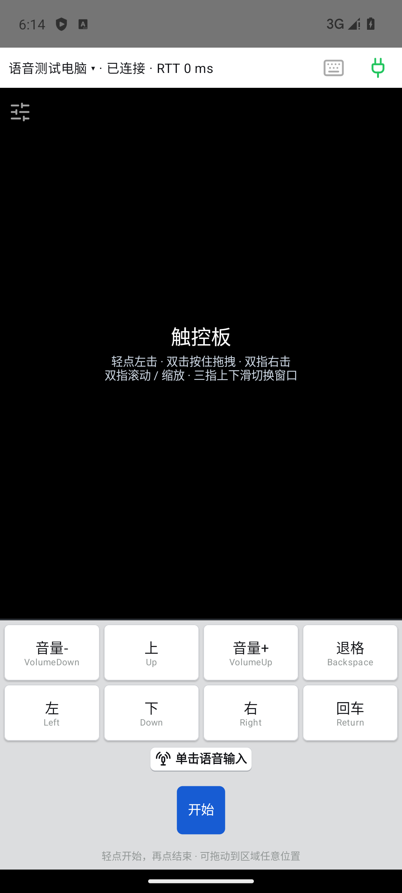
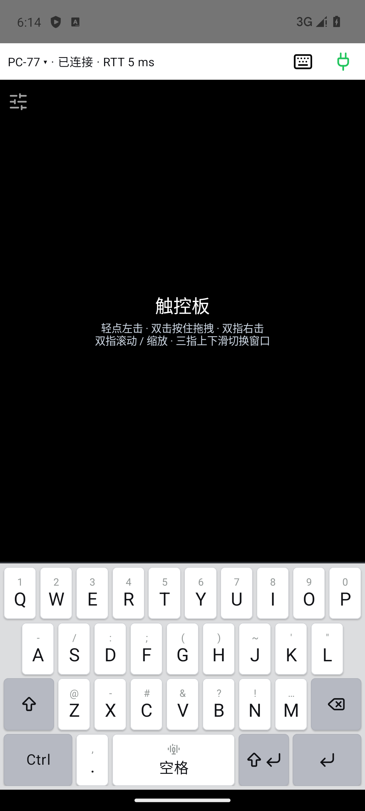

# TapDeck

通过 Wi-Fi 局域网，把 Android 手机变成 Windows 电脑的麦克风、触控板、键盘和随身屏幕，并把电脑通知同步到手机，方便 Vibe Coding 和日常操作。

**[Windows EXE](https://github.com/fly3457/TapDeck/releases/download/v0.5.21/TapDeck-0.5.21.exe) · [Android APK](https://github.com/fly3457/TapDeck/releases/download/v0.5.21/TapDeck-0.5.21.apk) · [完整下载与校验](https://github.com/fly3457/TapDeck/releases/tag/v0.5.21)**

当前测试版 **0.5.21** · Android **code 46** · Windows 11 x64 · Android 8 及以上 · 同一局域网

Android APK 为不可调试的 release 构建，可直接覆盖已安装的官方版，配对和手机设置都会保留。

## 能做什么

**语音传音**：手机麦克风把声音传到 PC，由豆包等输入法或支持语音输入的 Agent 软件转成文字。最多三组语音配置，长按或单击开始、结束。

**触控板与键盘**：支持点击、拖拽、双指滚动与缩放、三指窗口操作；可切换全键盘，输入字母、数字、符号和组合键；最多八个自定义快捷键。

**视频模式（手机当随身屏幕）**：手机整屏显示 PC 画面，点哪里就操作哪里，横竖屏都可用，见[视频模式](docs/video-mode.md)。
- 硬件 H.264 低延迟传画面，实测（RTX 2060 + 努比亚）画面基本静止时端到端延迟约 30 ms、滚动网页约 40 ms；顶部实时显示帧率和延迟。
- 同步播放电脑的声音，可在“更多”菜单中关闭。
- 单指拖动平移画面，甩手后有惯性；竖着拖到画面上下边缘再继续拖，会转成电脑滚轮，单指就能滚动阅读瀑布流页面；双指滚动与缩放画面。
- 可开启体感控制，转动手机平移画面。
- 配有语音悬浮球、半透明叠加的快捷键盘／全键盘和通知铃铛；体感、键盘和声音开关下次进入时自动恢复。

**电脑通知转发**：Windows 系统通知直接转发到手机，不需要逐个软件对接，后台和锁屏时也能收到；Claude Code、Codex 等 Agent 完成任务时可同步提醒，见[电脑通知转发](docs/notifications.md)。

**多设备与偏好**：一部手机可配对多台 PC 并切换控制，一台 PC 最多连接五个控制端。灵敏度、震动和控件位置按手机单独保存。可开启空闲黑屏屏保（默认关闭）：手机常插着电脑时，一段时间不碰就黑屏并显示缓慢移动的时钟，防止 OLED 烧屏；不锁屏，碰一下即恢复，见[界面说明](docs/android-ui.md#空闲黑屏屏保)。

配对与控制都走加密的局域网连接。

## 视频模式手势

| 操作 | 效果 |
|---|---|
| 轻点 / 长按 | 左键单击 / 右键单击 |
| 双击 / 双击后按住移动 | 左键双击 / 按住左键拖拽（拖窗口、框选、拖文件） |
| 单指拖动 | 平移画面，抬手后按惯性继续滑一段 |
| 单指竖着拖到画面上下边缘后继续拖 | 转成电脑滚轮，页面大致 1:1 跟手，带惯性；滚完 1 秒内竖拖仍直接滚动 |
| 双指轻点 | 右键单击 |
| 双指滑动 / 捏合 | 电脑滚轮 / 缩放手机上的画面 |
| 三指上滑 / 下滑 | 任务视图与桌面操作 |

开始拖动时会判定一次方向：横拖只平移画面，不会被误判成滚动。完整说明见[视频模式手势](docs/video-mode.md#手势)。

## 首次使用

1. 在 PC 运行 EXE，在手机安装 APK。PC“连接”页也能扫码下载内置的 APK。
2. 手机扫码填写 PC 连接网址，点击“连接”；在 PC 上核对校验码并允许。首次运行新版 EXE 时，Windows 防火墙会弹出提示，请选择“允许”，否则手机连不上。
3. 首次运行会检测虚拟键盘和虚拟声卡，缺少时提示安装。虚拟键盘用于触发豆包等输入法的语音热键，虚拟声卡用于把手机音频接入电脑麦克风。只用触控板、键盘和视频模式时可以不装。
4. 使用语音输入时，在系统、输入法或 Agent 中把麦克风选为 **CABLE Output**。语音热键要与目标软件的触发快捷键一致，留空则无法触发目标软件，只能直接传输音频。保存配置并让目标输入框获得焦点，再从手机开始语音。
5. 转发电脑通知时，在 Windows“设置 → 隐私和安全性 → 通知”中允许应用访问通知；手机上允许 TapDeck 发送通知并后台运行（关闭电池优化），否则锁屏后可能收不到。Agent 提醒的配置可在 PC“通知”页一键复制。

推荐配合[豆包输入法 Windows 版](https://ime.doubao.com/pc)使用。TapDeck 负责传音和触发热键，语音识别由输入法或 Agent 软件完成。详细步骤见[安装与配对](docs/installation.md)。

## 界面

  
  

界面示例使用测试配置；实机验收范围见[验证记录](docs/verification.md)。

## 致谢

- 感谢 [Ryochan7 / FakerInput](https://github.com/Ryochan7/FakerInput) 提供虚拟键盘。首次使用豆包等输入法的语音热键时需要它，让输入法顺利接收按键；不需要这类功能可不安装。
- 感谢 [VB-Audio / VB-CABLE](https://vb-audio.com/Cable/) 提供虚拟声卡，将手机传来的音频交给 PC 麦克风输入；不需要手机传音可不安装。VB-CABLE 是 donationware，可在官网捐赠或购买许可。
- 视频模式内嵌按 LGPL-2.1 构建的 [FFmpeg](https://ffmpeg.org/)，用于截屏与硬件编码；对应源码随每个 Release 一同发布。

TapDeck 采用 [MIT 许可证](LICENSE)，第三方组件适用各自许可，详见[第三方声明](THIRD_PARTY_NOTICES.md)。

## 文档与开发

[使用与开发文档](docs/README.md) · [控制协议](protocol/README.md) · [版本与发布规则](docs/versioning.md)

先配置 [Android 发布签名](docs/android-release.md)，再从仓库根目录构建：`powershell -File scripts/build-windows.ps1`。该流程构建并核验不可调试的 Android release APK，再内嵌并核验 Windows 产物。
